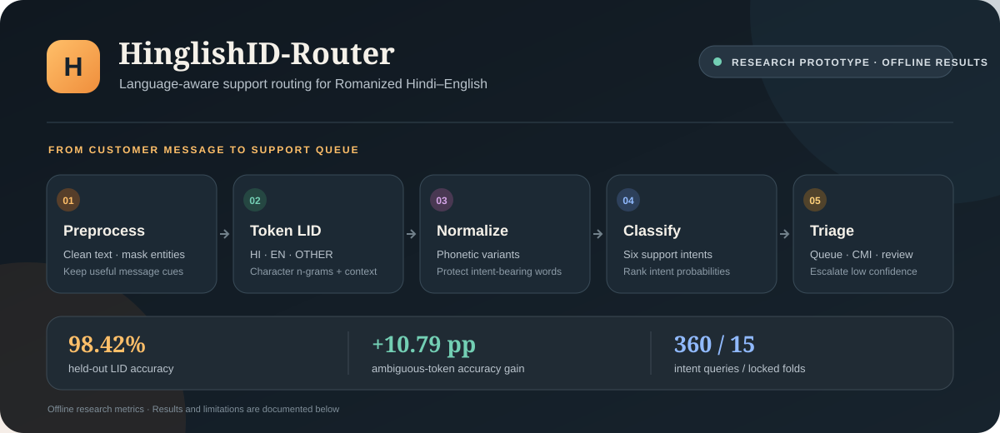
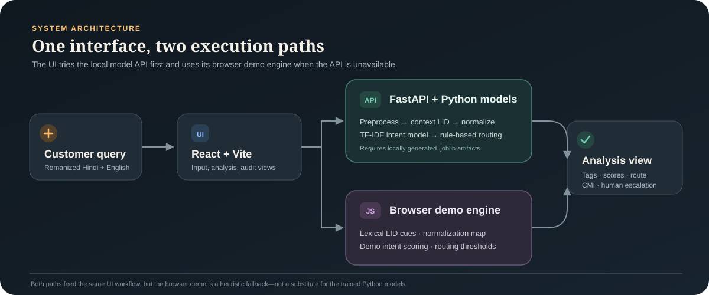
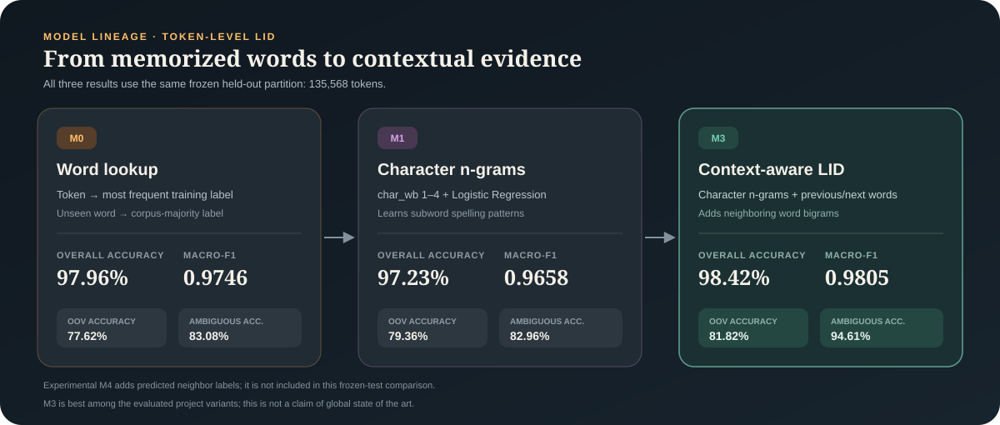
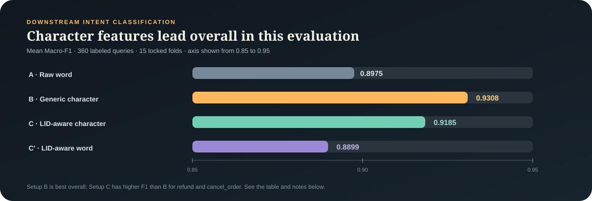

# HinglishID-Router

**Word-level Hindi–English language identification, spelling normalization, intent classification, and support-queue triage for Romanized Hinglish messages.**

  

  <a href="#problem-statement">Problem</a> ·
  <a href="#proposed-solution">Solution</a> ·
  <a href="#technical-architecture">Architecture</a> ·
  <a href="#from-baseline-to-best-performing-lid-model">Model lineage</a> ·
  <a href="#evaluation-results">Results</a> ·
  <a href="#quick-start-web-interface">Quick start</a> ·
  <a href="#limitations-and-operational-notes">Limitations</a>

  
  
  
  

HinglishID-Router is a research prototype and interactive demo for customer-support workflows. The current web UI runs as a React/Vite application. It can analyze messages with a browser-side demo engine and can use an optional local FastAPI service backed by serialized scikit-learn models.

> **Status:** Research prototype. Reported scores are offline evaluation results, not a service-level or production deployment guarantee.

## Why this project

<table>
  <tbody>
    <tr>
      <td width="33%" valign="top">
        <h3>🧠 Context-aware language ID</h3>
        
Tag Romanized Hindi and English at the token level, including words whose language depends on neighboring context.

      </td>
      <td width="33%" valign="top">
        <h3>🛡️ Keep intent signals</h3>
        
Language-aware normalization protects negations and question words that generic stopword handling can discard.

      </td>
      <td width="33%" valign="top">
        <h3>🔎 Inspect every stage</h3>
        
Review tokens, transformations, intent scores, and the reason behind a routing decision.

      </td>
    </tr>
    <tr>
      <td width="33%" valign="top">
        <h3>🧭 Triage code-mixing</h3>
        
Use a Code-Mixing Index threshold to flag messages for a bilingual support workflow.

      </td>
      <td width="33%" valign="top">
        <h3>🙋 Escalate uncertainty</h3>
        
Send low-confidence predictions to a human-review queue instead of relying on an uncertain route.

      </td>
      <td width="33%" valign="top">
        <h3>📊 Report mixed results</h3>
        
Compare the LID-aware approach with generic character n-grams and disclose where each performs best.

      </td>
    </tr>
  </tbody>
</table>

## Get started in a minute

<table>
  <tbody>
    <tr>
      <td width="50%" valign="top">
        <h3>🌐 Explore the web interface</h3>
        
Start the Vite app and try the browser-side demo. It can run without trained Python model files.

        <a href="#quick-start-web-interface">Run the interface →</a>
      </td>
      <td width="50%" valign="top">
        <h3>🧪 Run the trained-model path</h3>
        
Generate local model artifacts, then start the optional FastAPI service for backend analysis.

        <a href="#optional-python-api-and-trained-models">Set up the API →</a>
      </td>
    </tr>
  </tbody>
</table>

## Problem statement

Customer messages in Indian support channels often mix Hindi and English in Latin script. For example: “Mera order abhi tak nahi aaya, please refund karo.” A pipeline built for English-only text can mishandle Hindi function words, informal transliteration variants, and homographs whose language depends on surrounding words. Those errors can alter intent signals such as negation, make intent classification less reliable, and send a query to the wrong support queue.

The project studies how token-level language identification and language-aware normalization affect this workflow, and how a routing layer can make uncertainty and substantial code-mixing visible to support operations.

## Proposed solution

The system processes each query through an explainable, five-stage pipeline:

1. **Preprocessing:** Normalize whitespace and repeated characters; the Python path masks URLs, order identifiers, and emoji. The browser demo also masks phone-like numeric patterns.
2. **Token-level language identification (LID):** Assign tokens one of three labels: <code>HI</code>, <code>EN</code>, or <code>OTHER</code>. The production research model uses character-boundary n-grams and neighboring-word context to help disambiguate shared Hindi–English forms.
3. **Language-aware normalization:** Apply a phonetic normalization map to Hindi tokens while protecting intent-bearing negations and question words. Apply language-specific stopword handling.
4. **Intent classification:** Estimate one of six support intents: <code>refund</code>, <code>cancel_order</code>, <code>order_not_delivered</code>, <code>delivery_delay</code>, <code>payment_failed</code>, or <code>other</code>.
5. **Triage and routing:** Map the predicted intent to a support queue, flag queries at or above the configurable Code-Mixing Index (CMI) threshold, and send low-confidence predictions to human review.

The default routing thresholds are confidence below <code>0.50</code> for human escalation and CMI at or above <code>30%</code> for the bilingual-support flag. They are configurable in the UI and API.

## Intended use

- Inspect token-level language tags, normalization decisions, and intent probabilities.
- Compare raw-text, generic character n-gram, and LID-aware text-processing setups.
- Demonstrate intent-based support queue mapping and confidence/CMI-based triage.
- Reproduce the research evaluations from the included scripts and result artifacts.

The browser-side engine is a lightweight demonstration implementation. Use the Python service and generated model artifacts when evaluating the trained-model path.

## Technical architecture

| Layer | Implementation |
| --- | --- |
| Web interface | React 19 and Vite; interactive pipeline views, examples, thresholds, comparison, and audit drawer |
| Browser demo | JavaScript preprocessing, token-level language heuristics, normalization map, intent scoring, and routing; used when the API is unavailable |
| API | FastAPI with Uvicorn; <code>GET /api/health</code> and <code>POST /api/analyze</code> |
| LID model | Scikit-learn character <code>char_wb</code> n-gram Logistic Regression with neighboring-token context |
| Normalization | Rule-based transliteration map in <code>data/norm_map.json</code>, with protected negation and question signals |
| Intent model | Scikit-learn TF-IDF and Logistic Regression; the offline study compares word and character features |
| Data and evaluation | CoNLL LID splits, a 360-query intent dataset, locked cross-validation splits, pytest, and JSON/CSV result artifacts |

  

The application exposes per-token tags, normalized text, language-specific audit information, intent scores, and the routing rationale so a reviewer can inspect the intermediate decisions.

## From baseline to best-performing LID model

The language-identification experiments progress from a word lookup baseline to character features and then sentence context. The three models below were evaluated on the same frozen 135,568-token test split.

  

| Model | What it learns | Accuracy | Macro-F1 | OOV accuracy | Ambiguous-token accuracy |
| --- | --- | ---: | ---: | ---: | ---: |
| M0: Word lookup | Maps each seen token to its most frequent language label; unseen tokens use the corpus-majority label | 97.96% | 0.9746 | 77.62% | 83.08% |
| M1: Character n-grams | Logistic Regression over character-boundary n-grams (1–4); generalizes over subword spelling patterns but does not use neighboring words | 97.23% | 0.9658 | 79.36% | 82.96% |
| M3: Context-aware | Combines character n-grams with previous/next-word features and word bigrams to resolve context-dependent forms | **98.42%** | **0.9805** | **81.82%** | **94.61%** |

The code also implements an experimental M4 two-pass variant that adds predicted neighboring language labels as features. M4 is not included in the frozen held-out test comparison above; the checked-in final test report evaluates M3.

M3 is the strongest of these project-tested LID variants on the held-out evaluation. “Best-performing” here is scoped to this repository’s experiments; it is **not** a claim of state of the art against all published systems.

## Evaluation results

The following values are read from the checked-in artifacts under <code>results/</code>. They describe the supplied research datasets and evaluation protocols.

### Held-out language identification

The frozen test partition contains 135,568 tokens.

| Model | Accuracy | Macro-F1 |
| --- | ---: | ---: |
| Word-lookup baseline | 97.96% | 0.9746 |
| Character n-gram Logistic Regression, no context | 97.23% | 0.9658 |
| Context-aware character n-gram model | **98.42%** | **0.9805** |

On the evaluated ambiguous-token set, the context model scores 94.96% pooled accuracy versus 84.18% for the majority/lookup baseline, a gain of 10.79 percentage points.

### Downstream intent classification

Results are means over 15 locked folds on 360 labeled queries.

  

| Setup | Text features | Accuracy | Macro-F1 |
| --- | --- | ---: | ---: |
| A: Raw word baseline | Word-level features | 89.82% | 0.8975 |
| B: Generic character model | Character n-grams, no LID normalization | **93.06%** | **0.9308** |
| C: LID-aware character model | Character n-grams with language-aware normalization | 91.85% | 0.9185 |
| C′: LID-aware word model | Word-level features with normalization | 89.08% | 0.8899 |

Setup B has the strongest overall macro-F1 in this experiment. Setup C is not the overall winner, but has higher F1 than Setup B for the evaluated <code>refund</code> and <code>cancel_order</code> categories (0.9606 vs. 0.9555 and 0.9723 vs. 0.9697, respectively). The reported comparison between Setup C′ and Setup A is not statistically significant (95% bootstrap interval crosses zero; p = 0.117). These results are included to show both gains and limits of LID-aware normalization.

The separate three-rater annotation check reports Fleiss’ kappa of 0.9398 over 40 overlapping examples. This is an annotation-agreement result, not a model accuracy score.

## Quick start: web interface

Requirements: Node.js 20.19+ or 22.12+ and npm. These versions satisfy the Vite 8 engine requirement in <code>frontend/package.json</code>.

    git clone &lt;repository-url&gt;
    cd Hinglish_ID/frontend
    npm ci
    npm run dev

Open the local URL printed by Vite (normally <code>http://localhost:5173/</code>). If port 5173 is occupied, Vite may select another port.

The UI attempts to call the local API at <code>http://localhost:8000/api/analyze</code>. If the service is unavailable, it falls back to the browser-side demo engine and labels the source accordingly.

## Optional: Python API and trained models

Requirements: Python 3.11 is the project’s documented baseline. The API additionally requires FastAPI and Uvicorn, which are not listed in the current <code>requirements.txt</code>.

Create an environment and install the project dependencies:

    python -m venv .venv

On Windows PowerShell:

    .venv\Scripts\Activate.ps1

On macOS or Linux:

    source .venv/bin/activate

Then install packages and NLTK data:

    python -m pip install --upgrade pip
    python -m pip install -r requirements.txt
    python -m pip install fastapi uvicorn
    python -m nltk.downloader stopwords punkt punkt_tab

Serialized model files are excluded from version control. Generate them locally before starting the trained-model API:

    python src/train_lid_tagger.py
    python src/train_context_tagger.py
    python src/evaluate_final_test.py
    python src/run_intent_experiments.py

These scripts write model files under <code>models/</code> and may update evaluation artifacts under <code>results/</code>. The final LID evaluation intentionally uses the frozen test split; avoid rerunning it when you only need to inspect the checked-in results.

Start the API from the repository root:

    python -m uvicorn backend.server:app --host 127.0.0.1 --port 8000

The API expects <code>models/lid_final.joblib</code> and <code>models/intent_classifier_setup_c.joblib</code>.

### API reference

| Method | Path | Purpose |
| --- | --- | --- |
| <code>GET</code> | <code>/api/health</code> | Reports service health and whether model objects loaded |
| <code>POST</code> | <code>/api/analyze</code> | Analyzes a query and returns tokens, tags, CMI, transformed text, intent scores, and routing metadata |

The analysis request accepts a JSON object with a required <code>query</code> string and optional <code>conf_threshold</code> and <code>cmi_threshold</code> numeric values. Defaults are <code>0.50</code> and <code>30.0</code>, respectively.

## Alternative demo: Streamlit

The repository also contains a Streamlit interface. It uses the same local model artifacts:

    streamlit run app/demo.py

## Tests and frontend build

Run the Python test suite from the repository root:

    pytest

Build or lint the web interface from <code>frontend/</code>:

    npm run build
    npm run lint

## Data and reproducibility

- <code>data/processed/</code> contains the committed train, development, and held-out CoNLL partitions used by the LID experiments.
- <code>data/intent_dataset.csv</code> and <code>data/intent_splits_5fold.json</code> support the downstream intent experiment.
- The raw upstream LID corpus is not included under <code>data/raw/</code>. Obtain and use the source data according to its own access and redistribution terms.
- Check <code>results/</code> for the recorded JSON/CSV metrics and figures. The experiment scripts document the model configurations and evaluation protocol.
- Generated scikit-learn model files are ignored by Git and must be built locally for the Python API and Streamlit app.

## Limitations and operational notes

- Evaluation of downstream intents uses 360 labeled queries. Broader, time-based, and live-traffic validation is needed before operational use.
- The JavaScript fallback is a demo engine and is not the serialized Python model. Its predictions should not be treated as equivalent to the offline scikit-learn benchmark.
- The current FastAPI response populates its Setup A, B, and C result slots from the same prediction. Use the checked-in cross-validation artifacts for the independent setup comparison.
- The service currently has no authentication and configures permissive CORS. Keep it on a trusted local network; restrict origins and add authentication before exposing it to other users.
- Pattern-based masking is not a complete PII-removal guarantee. Do not submit production customer data to the demo without an approved data-handling and privacy review.
- The 30% CMI and 0.50 confidence thresholds are configurable research defaults, not universally validated operating thresholds. Keep a human review path for uncertain or high-impact cases.

## Repository layout

    app/                 Streamlit demo
    backend/             FastAPI service
    data/                Intent data, normalization resources, and processed LID splits
    docs/                Research notes, annotation guidance, and evaluation analysis
    frontend/             React/Vite interface and browser-side analysis engine
    models/               Locally generated, Git-ignored serialized models
    notebooks/           Exploratory analysis and demonstration notebooks
    results/              Evaluation tables, error analyses, and figures
    scripts/              Dataset and analysis helper scripts
    src/                  Python preprocessing, LID, normalization, evaluation, and routing
    tests/                Pytest suite

## Contributing

Keep changes reproducible and scoped. For changes to the Python pipeline, run <code>pytest</code>; for frontend changes, run <code>npm run build</code> from <code>frontend/</code>. Update the relevant result notes when changing an evaluation protocol or metric.

## License

No <code>LICENSE</code> file is currently present in the repository. Add an explicit license before redistributing this project or its data.

## Citation

The LID benchmark uses the LinCE code-switching evaluation work. Cite the source when using the benchmark or comparing results:

    @inproceedings{aguilar2020lince,
      title = {{LinCE}: A Centralized Benchmark for Linguistic Code-switching Evaluation},
      author = {Aguilar, Gustavo and Kar, Pranay and Solorio, Thamar},
      booktitle = {Proceedings of the 12th Language Resources and Evaluation Conference},
      pages = {1805--1813},
      year = {2020}
    }
