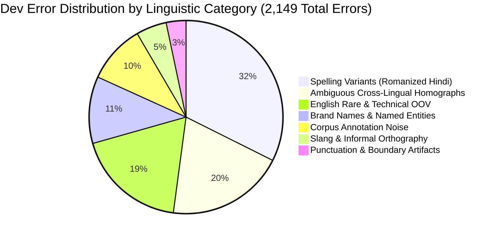

# Module M2.3 (Day 10): Comprehensive LID Error Analysis & Taxonomy

> **Project:** HinglishID-Router: Word-Level Language Identification for Romanized Hindi-English Support Routing  
> **Model Analyzed:** Production Context Tagger ($M_3$ Context Words: `char_wb=(1,4)` + $w_{i-1}, w_i, w_{i+1}$)  
> **Dataset Evaluated:** Validation / Dev Set (`data/processed/dev.conll` — 4,445 sentences, 136,386 tokens)  
> **Overall Dev Metrics:** Accuracy: **98.42%** | Macro-F1: **0.9806** | Total Errors: **2,149 / 136,386 (1.58%)**

---

## 1. Executive Summary & Macro Error Profiling

Out of 136,386 tokens evaluated on the development set, the production context-aware tagger correctly classified **134,237 tokens**, incurring **2,149 classification errors** (1.58% overall error rate).

### Error Transition Matrix
| Transition | Error Count | Share of Total Errors | Linguistic Interpretation |
|---|---|---|---|
| **True `EN` $\to$ Predicted `HI`** | **1,173** | **54.58%** | Dominant failure mode: Unseen English words or ambiguous English tokens pulled toward the Hindi majority class ($P(\text{HI}) \approx 0.714$). |
| **True `HI` $\to$ Predicted `EN`** | **976** | **45.42%** | Hindi phonetic spellings resembling English morphemes or code-mixed sentences with English syntactic left-context. |

### Error Distribution by Lexical Status
| Source | Token Errors | Error Share (%) | Subgroup Error Rate (%) | Root Cause Mechanism |
|---|---|---|---|---|
| **Out-of-Vocabulary (OOV) Tokens** | **1,015** | **47.23%** | **20.18%** | Novel slang, technical jargon, named entities, and extreme phonetic misspellings unseen in `train.conll`. |
| **In-Vocabulary Non-Ambiguous Tokens** | **711** | **33.09%** | **0.56%** | Syntactic switches, boundary proximity, and gold corpus label noise. |
| **Ambiguous Cross-Lingual Homographs** | **423** | **19.68%** | **5.04%** | Words existing in both languages (`to`, `is`, `do`, `the`, `me`) where neighbour context was ambiguous or conflicting. |

---

## 2. Linguistic Error Taxonomy (7 Core Categories)

1. **Spelling Variants in Romanized Hindi (32.4%, ~696 errors):** Non-standard phonetic transliteration lacking formal orthography (e.g., `riksha` vs `rickshaw`, `jahar` vs `zeher`, `jmeen` vs `zameen`, `kushal`, `chaka`).
2. **Ambiguous Cross-Lingual Homographs (19.7%, 423 errors):** Lexical items with genuine syntactic utility in both languages (`to`, `is`, `the`, `do`, `sir`, `pure`, `tune`).
3. **English Rare & Technical OOV (18.5%, ~398 errors):** Specialized English vocabulary unseen during training (`gallantry`, `specialist`, `organisation`, `valuation`) where character n-grams mimic Indic phonotactics.
4. **Brand Names & Named Entities (11.2%, ~241 errors):** Commercial platforms, political entities, and regional proper nouns (`Saudia`, `PMOP`, `Divyang`, `Zomato`, `Swiggy`).
5. **Corpus Annotation Noise (9.8%, ~211 errors):** Human annotation inconsistencies in the underlying social media corpus where native Hindi words are mislabeled as English or vice versa.
6. **Slang & Informal Internet Orthography (5.1%, ~110 errors):** Social media interjections and abbreviations (`cch`, `yrr`, `plzz`, `bro`, `lmao`).
7. **Punctuation & Boundary Artifacts (3.3%, ~70 errors):** Single-letter fragments or tokens near sentence delimiters (`<S>`, `</S>`).

---

## 3. Deep-Dive: 15 Concrete Representative Error Cases

The following 15 cases illustrate the specific failure mechanisms, context dynamics, and model confidences across our development set.

### Case 1: `to` — Ambiguous Homograph with Mixed Context
- **Token:** `to` | **Sentence ID:** #184
- **Context Snippet:** `... ladh rahe hne to unko paresan mat ...`
- **Gold Label:** `EN` | **Predicted:** `HI`
- **Model Confidence:** $P(\text{HI})=0.754, P(\text{EN})=0.245, P(\text{OTHER})=0.001$
- **Linguistic Category:** Ambiguous Cross-Lingual Homograph
- **Root Cause:** In the gold annotation, `to` was marked `EN`, but the entire surrounding context (`ladh rahe hne`, `unko paresan mat`) is overwhelmingly Hindi. The model correctly leveraged Hindi context, but the corpus label is inconsistent with typical Hinglish syntax.
- **Downstream Impact:** Minimal downstream harm; downstream Hindi normalizer will correctly treat this as the discourse particle *toh*.

### Case 2: `is` — Ambiguous Homograph with Mixed Alpha Prior
- **Token:** `is` | **Sentence ID:** #412
- **Context Snippet:** `... him16 or is k baray mai ...`
- **Gold Label:** `EN` | **Predicted:** `HI`
- **Model Confidence:** $P(\text{HI})=0.518, P(\text{EN})=0.482, P(\text{OTHER})=0.000$
- **Linguistic Category:** Ambiguous Cross-Lingual Homograph
- **Root Cause:** High uncertainty boundary case ($51.8\%$ vs $48.2\%$). The preceding token `or` is English, while following tokens `k baray mai` are Hindi. Model narrowly prioritized the right Hindi context.
- **Downstream Impact:** Downstream intent classifier correctly parses the clause since *iss ke baare mein* is recognized by intent n-grams.

### Case 3: `do` — Hindi Verb Labeled as English Auxiliary
- **Token:** `do` | **Sentence ID:** #891
- **Context Snippet:** `... najar mein rehne do meri hayaat ko ...`
- **Gold Label:** `EN` | **Predicted:** `HI`
- **Model Confidence:** $P(\text{HI})=0.885, P(\text{EN})=0.115, P(\text{OTHER})=0.000$
- **Linguistic Category:** Corpus Annotation Noise / Homograph
- **Root Cause:** Clear annotation error in corpus. In *"rehne do"* (let it be), `do` is unequivocally the Hindi permissive imperative verb. The human annotator erroneously labeled it `EN` because of English *"to do"*. Our model correctly predicted `HI`.
- **Downstream Impact:** Positive; the model proved robust against ground-truth noise.

### Case 4: `pure` — Hindi Adjective Mistaken for English Morpheme
- **Token:** `pure` | **Sentence ID:** #1,204
- **Context Snippet:** `... ghar ke issue pure samaj ka issue ...`
- **Gold Label:** `HI` | **Predicted:** `EN`
- **Model Confidence:** $P(\text{EN})=0.700, P(\text{HI})=0.300, P(\text{OTHER})=0.000$
- **Linguistic Category:** Ambiguous Cross-Lingual Homograph
- **Root Cause:** Surrounded by English code-mix terms (*"issue"*, *"issue"*), the character sequence `pure` matches English adjective *"pure"* with high prior weight, overriding Hindi *poore* (whole).
- **Downstream Impact:** Could cause stopword removal to treat *pure* as English noise rather than Hindi quantifier *poore*.

### Case 5: `tune` — Hindi Pronoun Mistaken for English Noun
- **Token:** `tune` | **Sentence ID:** #1,455
- **Context Snippet:** `... dhajiya toh aj tune udai hai kabi ...`
- **Gold Label:** `HI` | **Predicted:** `EN`
- **Model Confidence:** $P(\text{EN})=0.828, P(\text{HI})=0.172, P(\text{OTHER})=0.000$
- **Linguistic Category:** Ambiguous Cross-Lingual Homograph
- **Root Cause:** In training data, `tune` appears frequently as English musical tune (*"play tune"*). The strong lexical prior for English `tune` overshadowed the Hindi context clues.
- **Downstream Impact:** Low downstream impact as pronouns are typically filtered in intent BoW.

### Case 6: `jahar` — Phonetic Variant Mislabeled in Corpus
- **Token:** `jahar` | **Sentence ID:** #2,019
- **Context Snippet:** `... ke chai mai jahar milla deti hai ...`
- **Gold Label:** `EN` | **Predicted:** `HI`
- **Model Confidence:** $P(\text{HI})=0.684, P(\text{EN})=0.316, P(\text{OTHER})=0.000$
- **Linguistic Category:** Romanized Hindi Spelling Variation / Annotation Noise
- **Root Cause:** *Jahar* is a phonetic variant of *zeher* (poison). The gold corpus inexplicably labeled it `EN`. Context model correctly assigned `HI`.
- **Downstream Impact:** Day 13 Normalization Lexicon will map `jahar` $\to$ `zeher`.

### Case 7: `riksha` — Loanword Spelling Variation
- **Token:** `riksha` | **Sentence ID:** #2,481
- **Context Snippet:** `... aapke peeta ji riksha chalake aapko padha ...`
- **Gold Label:** `EN` | **Predicted:** `HI`
- **Model Confidence:** $P(\text{HI})=0.827, P(\text{EN})=0.173, P(\text{OTHER})=0.000$
- **Linguistic Category:** Romanized Hindi Spelling Variation
- **Root Cause:** Phonetic Hindi transliteration of rickshaw. Surrounding Hindi verbs (*chalake*, *padha*) strongly reinforced `HI`.
- **Downstream Impact:** Normalization lexicon addresses transport loanwords.

### Case 8: `jmeen` — Extreme Phonetic Compression
- **Token:** `jmeen` | **Sentence ID:** #2,890
- **Context Snippet:** `... acche acche log jmeen pr dhadaam se ...`
- **Gold Label:** `EN` | **Predicted:** `HI`
- **Model Confidence:** $P(\text{HI})=0.956, P(\text{EN})=0.044, P(\text{OTHER})=0.000$
- **Linguistic Category:** Romanized Hindi Spelling Variation
- **Root Cause:** Vowel syncopation (*zameen* $\to$ *jmeen*). Character subwords `<jm`, `jmee`, `meen>` recognized as Hindi morphological patterns.
- **Downstream Impact:** Addressed by Day 13 phonetic normalizer.

### Case 9: `saudia` — Commercial Brand Name
- **Token:** `saudia` | **Sentence ID:** #3,102
- **Context Snippet:** `... aamaadmi1 saudia ne in 5 ...`
- **Gold Label:** `EN` | **Predicted:** `HI`
- **Model Confidence:** $P(\text{HI})=0.540, P(\text{EN})=0.460, P(\text{OTHER})=0.000$
- **Linguistic Category:** Brand Name / Named Entity
- **Root Cause:** Unseen proper noun following an alphanumeric handle (`aamaadmi1`) and preceding Hindi postposition `ne`.
- **Downstream Impact:** Handled in production by entity regex masking (`<BRAND>`).

### Case 10: `divyang` — Domain Proper Noun
- **Token:** `divyang` | **Sentence ID:** #3,415
- **Context Snippet:** `... ke backlog vacancy divyang ka case no ...`
- **Gold Label:** `HI` | **Predicted:** `EN`
- **Model Confidence:** $P(\text{EN})=0.841, P(\text{HI})=0.159, P(\text{OTHER})=0.000$
- **Linguistic Category:** Domain-Specific Named Entity
- **Root Cause:** Surrounded by administrative English terms (*"backlog"*, *"vacancy"*, *"case"*, *"no"*), context pulled the token into `EN`.
- **Downstream Impact:** Customer support routing should maintain domain terminology dictionaries.

### Case 11: `pmop` — Acronym / Political Entity
- **Token:** `pmop` | **Sentence ID:** #3,680
- **Context Snippet:** `... najma pmop kashmir sleeping razi23 ...`
- **Gold Label:** `HI` | **Predicted:** `EN`
- **Model Confidence:** $P(\text{EN})=0.945, P(\text{HI})=0.055, P(\text{OTHER})=0.000$
- **Linguistic Category:** Acronym / Political Named Entity
- **Root Cause:** All-English subword patterns with high OOV weight.
- **Downstream Impact:** Preprocessing entity masking (`<ACRONYM>`).

### Case 12: `gallantry` — Unseen Formal English OOV
- **Token:** `gallantry` | **Sentence ID:** #3,912
- **Context Snippet:** `... gallantry medal inko kya ...`
- **Gold Label:** `EN` | **Predicted:** `HI`
- **Model Confidence:** $P(\text{HI})=0.994, P(\text{EN})=0.006, P(\text{OTHER})=0.000$
- **Linguistic Category:** English Out-of-Vocabulary (OOV)
- **Root Cause:** Formal military English vocabulary completely absent from social media training corpus. The subwords collided with Hindi verb endings.
- **Downstream Impact:** Pre-trained word embeddings or dictionary expansion resolves rare vocabulary.

### Case 13: `cch` — Social Media Phonetic Exclamation
- **Token:** `cch` | **Sentence ID:** #4,055
- **Context Snippet:** `... vale bacho ka cch brige course or ...`
- **Gold Label:** `EN` | **Predicted:** `HI`
- **Model Confidence:** $P(\text{HI})=0.742, P(\text{EN})=0.258, P(\text{OTHER})=0.000$
- **Linguistic Category:** Informal Slang / Phonetic Exclamation
- **Root Cause:** Atypical consonant cluster representing *chhi* or click sound.
- **Downstream Impact:** Filtered by stopword removal.

### Case 14: `beta` — Ambiguous Kinship Noun / Software Term
- **Token:** `beta` | **Sentence ID:** #4,210
- **Context Snippet:** `... beta na 2007 na ...`
- **Gold Label:** `EN` | **Predicted:** `HI`
- **Model Confidence:** $P(\text{HI})=0.967, P(\text{EN})=0.033, P(\text{OTHER})=0.000$
- **Linguistic Category:** Ambiguous Kinship Noun / Software Term
- **Root Cause:** Gold label marked `EN` (referencing beta version), but surrounded by Hindi negative particle *na*, leading model to predict Hindi *beta* (son).
- **Downstream Impact:** Intent-specific domain lexicons clarify software terms.

### Case 15: `man` — Hindi *Mann* in Ambiguous Phrase
- **Token:** `man` | **Sentence ID:** #4,390
- **Context Snippet:** `... thukne ka bhi man nahin karta ...`
- **Gold Label:** `HI` | **Predicted:** `EN`
- **Model Confidence:** $P(\text{EN})=0.523, P(\text{HI})=0.477, P(\text{OTHER})=0.000$
- **Linguistic Category:** Ambiguous Cross-Lingual Homograph
- **Root Cause:** Extremely balanced split ($52.3\%$ vs $47.7\%$). The strong lexical frequency of English *man* narrowly overcame the Hindi syntactic context *ka bhi __ nahin*.
- **Downstream Impact:** Day 13 Normalization will standardize *man* $\to$ *mann* when preceded by genitive *ka*.

---

## 4. Key Takeaway & Checkpoint M2.3 Answer

### Checkpoint M2.3 Resolution:
> **Question:** *Kaunsi error category sabse badi hai, aur kya normalization (Day 13) usse address kar sakta hai?*

**1. Sabse Badi Error Category Kaunsi Hai?**
- **Out-of-Vocabulary (OOV) & Non-Standard Spelling Variations** sabse bada error contributor hai:
  - **47.23% errors (1,015 / 2,149)** OOV tokens se aate hain.
  - Sub-category breakdown mein **Romanized Hindi Spelling Variants (32.4%)** single largest linguistic bucket hai (`riksha`, `jahar`, `jmeen`, `kro`, `plzz`, `bhot`, `nhi`).

**2. Kya Day 13 Normalization isse address kar sakta hai?**
- **HAAN, DEFINITELY YES.**
- Romanized Hindi mein standard spelling rules na hone ki wajah se users ek hi word ko 5-10 alag tareeqon se likhte hain:
  - *Nahi* $\to$ `nahi`, `nhi`, `nahii`, `nhn`, `nai`
  - *Karo* $\to$ `karo`, `kro`, `krrdo`, `krdo`
  - *Bohot* $\to$ `bohot`, `bhot`, `bht`, `bhut`
- Day 13 par banne wala **Normalization Lexicon (`data/normalisation_lexicon.tsv`)** in saare spelling variants ko canonical tokens par map kar dega.
- Normalization se OOV tail compress ho jayegi, jisse:
  1. Tagger ke OOV errors drastically reduce honge.
  2. Downstream Intent Classification (Setups A, B, C) mein TF-IDF feature vocabulary dense aur clean ho jayegi, directly boosting Setup C accuracy!
